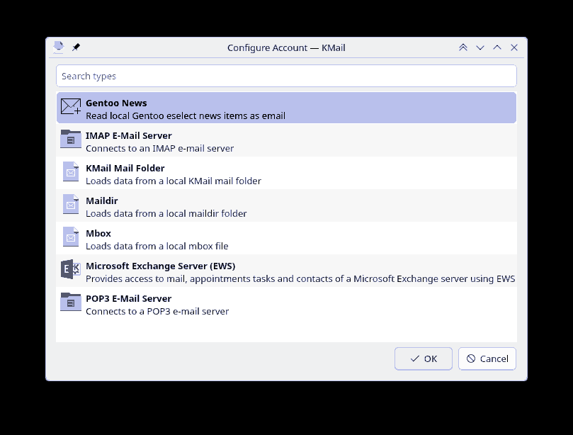

<!--
SPDX-FileCopyrightText: 2026 Arran Ubels <arran4@gmail.com>
SPDX-License-Identifier: CC-BY-SA-4.0 OR LGPL-2.1-or-later
-->

# Gentoo News for KMail

Read Gentoo and overlay news directly in KMail using a native KDE PIM 6 Akonadi resource. News notices appear as ordinary plain-text messages in their own account, with the original title, publication date and article text. No IMAP server, mail export or background root service is needed.

## Features

- A single **Gentoo News** account, with a folder for each configured Portage repository.
- Relevant and previously queued news in the repository folder; other published notices in **Skipped**.
- Read/unread status follows Portage's news state when available. Skipped notices are always marked read.
- Local, read-only access to installed repositories; no network requests by the resource and no changes to Portage news state.
- Stable message identities, standard KMail searching and reading, and periodic or manual synchronization.

## Installation

Requires Gentoo with a working KDE PIM 6 / Akonadi and KMail installation.

### From the public overlay (recommended)

The package is available in [arran4/arrans_overlay](https://github.com/arran4/arrans_overlay) (Portage repository name `arrans-overlay`). Follow the overlay's [setup instructions](https://github.com/arran4/arrans_overlay/blob/main/readme.md) first if you have not configured it, including its required masters.

```sh
sudo emaint sync -r arrans-overlay
sudo emerge --ask kde-apps/kmail-eselect-news::arrans-overlay
```

The package is currently keyworded `~amd64`. If Portage reports a keyword mask, accept `~amd64` specifically for `kde-apps/kmail-eselect-news::arrans-overlay` using your normal package.accept_keywords configuration or review Portage's autounmask suggestions. No private repository credentials are needed.

### Enable the account

1. Close KMail, Kontact and other KDE PIM applications.
2. Run `akonadictl restart` as your normal desktop user (not root).
3. Open KMail. Go to **Settings → Configure KMail → Accounts → Receiving → Add**.
4. Choose **Gentoo News**. The repository folders appear in the folder list after synchronization.



Already using Gentoo News from the private development overlay? Install the public package using the repository-qualified command above. Keep the existing KMail account; do not remove and recreate it.

For source builds, development or testing, see [CONTRIBUTING.md](CONTRIBUTING.md). Source archives are available under [Releases](https://github.com/arran4/kmail-eselect-news/releases).

## Using Gentoo News

Each repository is a mailbox with a **Skipped** subfolder. For example:

```text
Gentoo News
├── gentoo
│   └── Skipped
└── guru
    └── Skipped
```

The main repository folder shows articles known to Portage (read, unread or previously queued); **Skipped** contains published articles not recorded in any of those state lists. This lets you browse the wider news archive without adding unread notifications for articles Portage has not selected.

| Portage state | Folder | Status |
| --- | --- | --- |
| In `.read` | Repository | Read |
| In `.unread`, not in `.read` | Repository | Unread |
| Only in `.skip` | Repository | Read |
| Known absent from all three | Skipped | Read |
| State uncertain, no known unread entry | Repository | Read |

Portage's `.skip` is previously queued history, not a list of irrelevant articles. If an article becomes relevant later, it can move from Skipped into the repository folder on synchronization.

**Reading an article in KMail does not acknowledge it to Gentoo.** The resource is read-only. Continue using `eselect news list`, `eselect news read` and other normal eselect commands to manage system news. The next synchronization reflects the system state.

Use KMail's Check Mail or folder synchronization to refresh. The resource also requests a 15-minute Akonadi polling interval. Repositories with no news have empty folders. English news is supported currently.

## Troubleshooting

If the account type is missing after installation, close KDE PIM applications and restart Akonadi as described above. If the account is present but folders or messages are missing, synchronize it and check that the repository and news files are readable by your desktop user.

```sh
akonadictl status
portageq get_repos /
eselect news list
ls -l /var/lib/gentoo/news/
journalctl --user -b --no-pager | grep -Ei 'akonadi|eselect.news' | tail -n 100
```

For unexpected folder placement or read status, open the message's raw source in KMail and inspect the `X-Gentoo-News-*` headers. These identify the repository, article ID, full source filename, state directory, membership in each of the three state lists, effective read state and intended folder. Membership values are `yes`, `no` or `unknown`; file status is `ok`, `missing`, `partial` or `unavailable`. The effective-state header reports the resource's classification, not a read-back of Akonadi's current flags.

Do not run KMail or Akonadi as root, change Portage's news files to troubleshoot, or reset the Akonadi database. Report problems on the [issue tracker](https://github.com/arran4/kmail-eselect-news/issues) with versions, relevant logs and diagnostic headers (review paths for private information before sharing).

## Uninstall

Remove the Gentoo News receiving account through KMail, then uninstall the package with Portage:

```sh
sudo emerge --ask --depclean kde-apps/kmail-eselect-news
```

If the package is explicitly selected in your world file, deselect it first with `sudo emerge --ask --deselect kde-apps/kmail-eselect-news`. Close KDE PIM applications and restart Akonadi if necessary. System news remains untouched.

## Project status

The resource has been installed and used successfully on a Gentoo/KDE PIM 6 desktop with repository folders and readable articles. It is an independent early-stage project, not an official Gentoo or KDE component. Other environments and edge cases may require further testing.

## Credits and licensing

Copyright 2026 Arran Ubels ([arran4](https://github.com/arran4)), project initiator and maintainer. Initial implementation and tests were developed with assistance from OpenAI ChatGPT.

Thanks to the KDE PIM community for Akonadi and KMime. The [Maildir resource](https://invent.kde.org/pim/kdepim-runtime/-/tree/master/resources/maildir), including work by Till Adam and Daniel Vrátil, served as a reference for resource and payload retrieval patterns. Thanks to Gentoo contributors for [GLEP 42](https://www.gentoo.org/glep/glep-0042.html), Portage and the news articles. These credits do not imply upstream endorsement or authorship of this project.

| Files | License |
| --- | --- |
| C++ source, tests and resource metadata | [LGPL-2.1-or-later](LICENSES/LGPL-2.1-or-later.txt) |
| CMake and GitHub Actions | [BSD-2-Clause](LICENSES/BSD-2-Clause.txt) |
| README | [CC-BY-SA-4.0](LICENSES/CC-BY-SA-4.0.txt) or [LGPL-2.1-or-later](LICENSES/LGPL-2.1-or-later.txt), at your option |
| Ignore list | [CC0-1.0](LICENSES/CC0-1.0.txt) |

Per-file SPDX notices and complete license texts follow REUSE conventions. Third-party libraries and news articles read at runtime retain their respective licenses and copyright.

See [CONTRIBUTING.md](CONTRIBUTING.md) for architecture, building, test fixtures and upstream adoption notes.
