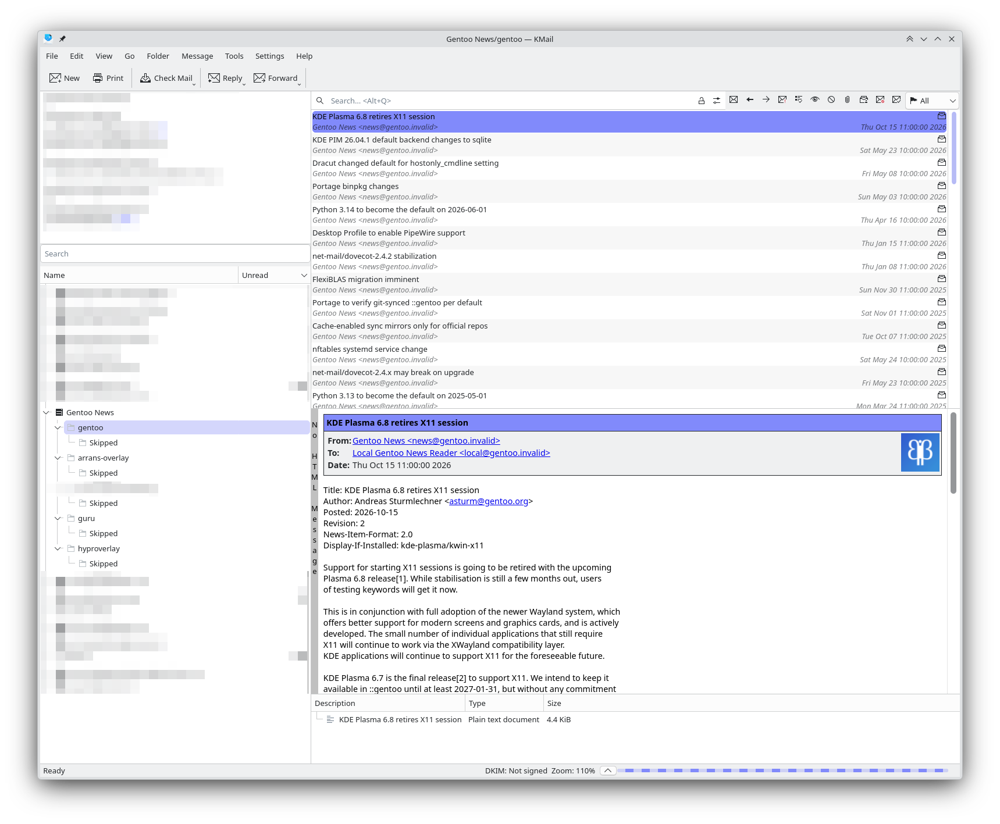

<!--
SPDX-FileCopyrightText: 2026 Arran Ubels <arran4@gmail.com>
SPDX-License-Identifier: CC-BY-SA-4.0 OR LGPL-2.1-or-later
-->

# Gentoo News for KMail

Read Gentoo and overlay news directly in KMail using a native KDE PIM 6 Akonadi resource. News notices appear as ordinary plain-text messages in their own account, with the original title, publication date and article text. No IMAP server, mail export or background root service is needed.



## Features

- A single **Gentoo News** account, with a folder for each configured Portage repository.
- Relevant and previously queued news in the repository folder; other published notices in **Skipped**.
- Read/unread status follows Portage's news state when available. Skipped notices are always marked read.
- Local, read-only access to installed repositories; no network requests by the resource and no changes to Portage news state.
- Stable message identities, standard KMail searching and reading, and periodic or manual synchronization.

## Installation

Requires Gentoo with a working KDE PIM 6 / Akonadi and KMail installation.

### From the public overlay (recommended)

The package is available in [arran4/arrans_overlay](https://github.com/arran4/arrans_overlay), whose Portage repository name is `arrans-overlay`. If you already use this overlay, skip directly to installing the package.

For a new overlay setup, install the repository management module:

```sh
sudo emerge --ask app-eselect/eselect-repository
eselect repository list
```

Enable the overlay:

```sh
sudo eselect repository enable arrans-overlay
```

Alternatively, if it is not in the eselect repository index, add it directly:

```sh
sudo eselect repository add arrans-overlay git https://github.com/arran4/arrans_overlay.git
```

See the [overlay's setup instructions](https://github.com/arran4/arrans_overlay/blob/main/readme.md) for repository-specific configuration.

Synchronize the repositories after adding them:

```sh
sudo emerge --sync
```

For an already configured overlay, `sudo emaint sync -r arrans-overlay` updates just that repository. Install the package with:

```sh
sudo emerge --ask kde-apps/kmail-eselect-news::arrans-overlay
```

The package is currently keyworded `~amd64`. If Portage reports a keyword mask, accept `~amd64` specifically for `kde-apps/kmail-eselect-news::arrans-overlay` using your normal package.accept_keywords configuration or review Portage's autounmask suggestions. No private repository credentials are needed. To let Portage propose and apply the necessary keyword changes, use:

```sh
sudo emerge --ask --verbose kde-apps/kmail-eselect-news::arrans-overlay \
    --autounmask --autounmask-write --autounmask-continue
```

Review any proposed changes before accepting them.

### Enable the account

1. Close KMail, Kontact and other KDE PIM applications.
2. Run `akonadictl restart` as your normal desktop user (not root).
3. Open KMail. Go to **Settings → Configure KMail → Accounts → Receiving → Add**.
4. Choose **Gentoo News**. The repository folders appear in the folder list after synchronization.


Already using Gentoo News from the private development overlay? Install the public package using the repository-qualified command above. Keep the existing KMail account; do not remove and recreate it.

For source builds, see [Building from source](#building-from-source). Source archives are available under [Releases](https://github.com/arran4/kmail-eselect-news/releases).

## Using Gentoo News

Each repository is a mailbox with a **Skipped** subfolder. For example:

```text
Gentoo News
├── gentoo
│   └── Skipped
└── guru
    └── Skipped
```

The main repository folder shows articles known to Portage (read, unread or previously queued); **Skipped** contains published articles not recorded in any of those state lists. This lets you browse the wider news archive without adding unread notifications for articles Portage has not selected.

| Portage state | Folder | Status |
| --- | --- | --- |
| In `.read` | Repository | Read |
| In `.unread`, not in `.read` | Repository | Unread |
| Only in `.skip` | Repository | Read |
| Known absent from all three | Skipped | Read |
| State uncertain, no known unread entry | Repository | Read |

Portage's `.skip` is previously queued history, not a list of irrelevant articles. If an article becomes relevant later, it can move from Skipped into the repository folder on synchronization.

**Reading an article in KMail does not acknowledge it to Gentoo.** The resource is read-only. Continue using `eselect news list`, `eselect news read` and other normal eselect commands to manage system news. The next synchronization reflects the system state.

Use KMail's Check Mail or folder synchronization to refresh. The resource also requests a 15-minute Akonadi polling interval. Repositories with no news have empty folders. English news is supported currently.

## How it works

Gentoo News runs as a separate native Akonadi resource, registered by its desktop metadata file. The executable is `akonadi_eselect_news_resource`. It does not run an IMAP server or maintain a second mail store outside Akonadi.

### News discovery and synchronization

- Repository names come from `portageq get_repos /`; `portageq get_repo_path / <repository>` resolves each repository independently.
- English GLEP 42 articles are read from `metadata/news/<id>/<id>.en.txt` in each repository. Title becomes the subject, the date becomes the message date, and the complete original article (including its metadata and authors) becomes the UTF-8 text body.
- Read, unread and previously queued IDs come from `/var/lib/gentoo/news/news-<repository>.read`, `.unread` and `.skip`. Each file is read independently; valid entries survive malformed lines. Missing files in an accessible state directory are treated as empty.
- The repository name plus news ID forms the stable Akonadi remote ID and the basis for the synthetic Message-ID. Article edits and state changes update the message revision. An article removed from the repository is removed on the next successful synchronization; clearing Portage state alone does not remove it.
- An inaccessible repository or malformed article fails the affected synchronization rather than treating it as an empty mailbox. An incomplete or unreadable state file does not hide articles. No write access to the source is required.

### Optional configuration

No configuration file is necessary for normal use. Advanced users may override discovery using `${XDG_CONFIG_HOME:-$HOME/.config}/kmail-eselect-news.ini`:

```ini
[General]
repository=gentoo
newsDirectory=/var/db/repos/gentoo/metadata/news
stateDirectory=/var/lib/gentoo/news
```

All settings are optional. Omit `repository` and `newsDirectory` for automatic discovery of every configured repository; `repository` restricts discovery to one repository, while `newsDirectory` explicitly selects a source directory for that repository (defaulting to gentoo if the repository is not supplied). `stateDirectory` defaults to `/var/lib/gentoo/news`. The settings currently apply to every instance of the resource for the desktop user. Restart the resource after changing them.

The resource is implemented in C++ using Qt 6, KMime and Akonadi. `NewsResource` manages the collection tree and item synchronization; `NewsSource` / `loadNews` handle local filesystem discovery; `NewsArticle::message` converts articles into MIME messages. See [GLEP 42](https://www.gentoo.org/glep/glep-0042.html) for the Gentoo news format.

## Troubleshooting

If the account type is missing after installation, close KDE PIM applications and restart Akonadi as described above. If the account is present but folders or messages are missing, synchronize it and check that the repository and news files are readable by your desktop user.

```sh
command -v akonadi_eselect_news_resource
akonadictl status
portageq get_repos /
portageq get_repo_path / gentoo
eselect news list
ls -l /var/lib/gentoo/news/
journalctl --user -b --no-pager | grep -Ei 'akonadi|eselect.news' | tail -n 100
```

For unexpected folder placement or read status, open the message's raw source in KMail and inspect the `X-Gentoo-News-*` headers. These identify the repository, article ID, full source filename, state directory, membership in each of the three state lists, effective read state and intended folder. Membership values are `yes`, `no` or `unknown`; file status is `ok`, `missing`, `partial` or `unavailable`. The effective-state header reports the resource's classification, not a read-back of Akonadi's current flags.

Do not run KMail or Akonadi as root, change Portage's news files to troubleshoot, or reset the Akonadi database. Report problems on the [issue tracker](https://github.com/arran4/kmail-eselect-news/issues) with versions, relevant logs and diagnostic headers (review paths for private information before sharing).

## Uninstall

Remove the Gentoo News receiving account through KMail, then uninstall the package with Portage:

```sh
sudo emerge --ask --depclean kde-apps/kmail-eselect-news
```

If the package is explicitly selected in your world file, deselect it first with `sudo emerge --ask --deselect kde-apps/kmail-eselect-news`. Close KDE PIM applications and restart Akonadi if necessary. System news remains untouched.

## Building from source

### Requirements

- A C++20 compiler, CMake 3.22 or newer, and a build tool.
- KDE Extra CMake Modules (ECM), available as `kde-frameworks/extra-cmake-modules` on Gentoo.
- Qt 6 development libraries (Core, and Test for automated tests).
- KDE PIM 6 Akonadi development libraries and KMime (either KF6Mime or KPim6Mime CMake package, matching your installed stack).
- A running KDE PIM 6 session with Akonadi MIME support and KMail for live testing.
- A local Gentoo repository (Portage news state is optional), or an isolated test fixture.

Install dependencies through your distribution's package manager. No particular checkout path, CMake generator, or release tag is required.

### Configure, build and test

From the source directory:

```sh
cmake -S . -B build -DBUILD_TESTING=ON &&
cmake --build build &&
ctest --test-dir build --output-on-failure
```

Tests use temporary directories and do not touch system news state.

### Manual installation and removal

Only use manual installation if you are not managing the resource with a package manager. Configure the installation prefix to match the running Akonadi installation and ensure it can discover the executable and agent metadata. For example, on a system using /usr:

```sh
cmake -S . -B build -DCMAKE_INSTALL_PREFIX=/usr &&
cmake --build build &&
DESTDIR="$PWD/build/stage" cmake --install build
```

Review the staged files. If there is no package-managed installation and you want to install system-wide, run `sudo cmake --install build`. Never run the resource or Akonadi as root. Follow the [troubleshooting instructions](#troubleshooting).

Before removing a manual installation, remove the resource instance from KMail. Review `build/install_manifest.txt` and remove only files from this manual installation, not package-managed files. Restart Akonadi if needed. Do not delete its database.

## Project status

The resource has been installed and used successfully on a Gentoo/KDE PIM 6 desktop with repository folders and readable articles. It is an independent early-stage project, not an official Gentoo or KDE component. Other environments and edge cases may require further testing.

## Credits and licensing

Copyright 2026 Arran Ubels ([arran4](https://github.com/arran4)), project initiator and maintainer. Initial implementation and tests were developed with assistance from OpenAI ChatGPT.

Thanks to the KDE PIM community for Akonadi and KMime. The [Maildir resource](https://invent.kde.org/pim/kdepim-runtime/-/tree/master/resources/maildir), including work by Till Adam and Daniel Vrátil, served as a reference for resource and payload retrieval patterns. Thanks to Gentoo contributors for [GLEP 42](https://www.gentoo.org/glep/glep-0042.html), Portage and the news articles. These credits do not imply upstream endorsement or authorship of this project.

| Files | License |
| --- | --- |
| C++ source, tests and resource metadata | [LGPL-2.1-or-later](LICENSES/LGPL-2.1-or-later.txt) |
| CMake and GitHub Actions | [BSD-2-Clause](LICENSES/BSD-2-Clause.txt) |
| README | [CC-BY-SA-4.0](LICENSES/CC-BY-SA-4.0.txt) or [LGPL-2.1-or-later](LICENSES/LGPL-2.1-or-later.txt), at your option |
| Ignore list | [CC0-1.0](LICENSES/CC0-1.0.txt) |

Per-file SPDX notices and complete license texts follow REUSE conventions. Third-party libraries and news articles read at runtime retain their respective licenses and copyright.

