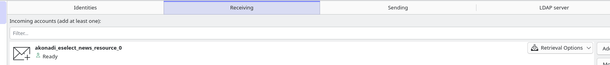

<!--
SPDX-FileCopyrightText: 2026 Arran Ubels <arran4@gmail.com>
SPDX-License-Identifier: CC-BY-SA-4.0 OR LGPL-2.1-or-later
-->

# kmail-eselect-news

An experimental native Akonadi resource for Gentoo GLEP 42 news, shown in KMail as ordinary plain-text emails. No IMAP, SMTP, maildir export, root service or network access is involved.

## Installation

On Gentoo, install from [arrans-private-overlay](https://github.com/arran4/arrans-private-overlay) (requires access to the private repositories):

```sh
sudo emaint sync -r arrans-private-overlay &&
sudo emerge --ask kde-apps/kmail-eselect-news
```

Close KDE PIM applications, run `akonadictl restart` as your desktop user, then add **Gentoo News** in KMail's receiving-account settings.

For other packaging environments or development builds, see [building from source](#building-from-source). For checking the installed resource, see [testing on Gentoo](#testing-the-installed-resource).

## Behaviour and boundaries

- One read-only collection, **Gentoo News (gentoo)**, for the selected Portage repository.
- Uses `portageq get_repo_path / gentoo` to find the local repository; reads English news under `metadata/news`.
- Only IDs in Portage's `news-<repository>.read` and `.unread` files are included, matching the relevant-news view rather than every published notice. Duplicates are collapsed; unread wins if both lists contain an ID.
- Title becomes the subject; publication date becomes the message date (midnight UTC); the entire original news text, including its metadata and authors, becomes the UTF-8 plain-text body. Synthetic sender/recipient and stable Message-ID make clear these are locally generated messages.
- Stable Akonadi remote ID is repository + news ID; revision hashes content and source read state. Edits update the same item. A successful full snapshot removes notices no longer in either list (e.g. after purge).
- The source is **never written**. KMail reading a message does not acknowledge it to Portage. Use eselect separately; the next sync reflects the source state. KMail may restrict local flag changes on a read-only folder.
- Missing or malformed referenced articles fail the snapshot rather than silently deleting existing cached mail. A missing state file is treated as empty; an inaccessible source/state directory is an error.
- Initially one repository, English only, no GUI configuration, no backend search or outgoing transport. No privilege elevation. Periodic polling requested via Akonadi cache policy (15 minutes); manual refresh is supported.
- This is an experimental resource; an ebuild is available in the private overlay. Live build and integration must be verified on a KDE PIM 6 host.

## Architecture

`NewsResource : Akonadi::ResourceBase` implements collection discovery, item synchronization, and batch payload retrieval. `NewsSource` and `loadNews` implement the independent filesystem backend; `NewsArticle::message` converts each record to a KMime message. The resource is its own process registered via a desktop metadata file.

References: [GLEP 42](https://www.gentoo.org/glep/glep-0042.html), [Akonadi ResourceBase](https://github.com/KDE/akonadi/blob/master/src/agentbase/resourcebase.h), [KDE Maildir resource](https://github.com/KDE/kdepim-runtime/tree/master/resources/maildir).

## Account registration

The screenshot below records the resource registered in KMail's Receiving settings during the initial Gentoo host test. It shows the pre-fix internal account identifier and Ready status, not a successful mail synchronization.



## Testing the installed resource

This guide assumes the resource is installed and you have a working KMail/Akonadi session. See the [installation instructions](#installation) if needed. No source checkout or manual installation is required.

### Smoke test

Run as your desktop user:

```sh
command -v akonadi_eselect_news_resource
akonadictl status
eselect news list
```

If the resource is not listed in KMail, close KDE PIM applications and run `akonadictl restart` as your desktop user. Open KMail and add **Gentoo News** under Settings → Configure KMail → Accounts → Receiving. Alternatively, add it through Akonadi Console's Agents tab.

Synchronize the account, then check:

- [ ] Relevant Gentoo notices appear as ordinary email messages.
- [ ] Subjects match news titles, dates match publication dates, and the full article appears in the message body (not an attachment).
- [ ] Initial read/unread state matches Portage.
- [ ] Repeated synchronization does not create duplicates.
- [ ] Opening a notice does not change Portage's read state.
- [ ] The folder does not advertise message creation or deletion.
- [ ] Restarting KMail/Akonadi preserves the collection and message identities.

An empty collection is valid if there are no relevant news items, but the collection itself should still appear. An account showing Ready with no collection is not proof of a successful sync. If it occurs, manually synchronize the resource from Akonadi Console's Agents tab and inspect Browser for its collection. The account should be named Gentoo News unless renamed by the user. Do not modify system news files just to test the resource.

### Optional regression testing

To exercise updates, purges and error recovery even when no real notices are available, use the [isolated integration fixture](#optional-isolated-integration-testing). Developers can run the automated tests as described in [building from source](#building-from-source).

### Troubleshooting

```sh
akonadictl status
portageq get_repo_path / gentoo
ls -l /var/lib/gentoo/news/
journalctl --user -b --no-pager | grep -Ei 'akonadi|eselect.news' | tail -n 100
```

Check resource status, synchronize and inspect collection/item metadata in Akonadi Console. Confirm your desktop user can read the news and state directories. Do not run KMail or Akonadi as root or reset the Akonadi database.

### Uninstall

Remove the Gentoo News account from KMail or Akonadi Console, then let Portage remove the installed files:

```sh
sudo emerge --ask --deselect kde-apps/kmail-eselect-news
sudo emerge --ask --depclean kde-apps/kmail-eselect-news
```

Close KDE PIM applications and restart Akonadi if necessary. For a manually installed development build, follow its [separate uninstall instructions](#manual-installation-and-removal).

### Validation status

The smoke test and integration checks are expected behaviour, not recorded successful results. Build and live integration have not yet been verified.

## Building from source

For development or packaging where a prebuilt package is unavailable. Gentoo users should normally use the [ebuild](#installation).

### Requirements

- A C++20 compiler, CMake 3.22 or newer, and a build tool.
- KDE Extra CMake Modules (ECM), available as `kde-frameworks/extra-cmake-modules` on Gentoo.
- Qt 6 development libraries (Core, and Test for automated tests).
- KDE PIM 6 Akonadi development libraries and KMime (either KF6Mime or KPim6Mime CMake package, matching your installed stack).
- A running KDE PIM 6 session with Akonadi MIME support and KMail for live testing.
- A local Gentoo repository and Portage news state, or an isolated test fixture.

Install dependencies through your distribution's package manager. No particular checkout path, CMake generator, or release tag is required.

### Configure, build and test

From the source directory:

```sh
cmake -S . -B build -DBUILD_TESTING=ON &&
cmake --build build &&
ctest --test-dir build --output-on-failure
```

Tests use temporary directories and do not touch system news state.

### Manual installation and removal

Only use manual installation if you are not managing the resource with a package manager. Configure the installation prefix to match the running Akonadi installation and ensure it can discover the executable and agent metadata. For example, on a system using /usr:

```sh
cmake -S . -B build -DCMAKE_INSTALL_PREFIX=/usr &&
cmake --build build &&
DESTDIR="$PWD/build/stage" cmake --install build
```

Review the staged files. If there is no package-managed installation and you want to install system-wide, run `sudo cmake --install build`. Never run the resource or Akonadi as root. Follow the [installed-resource smoke test](#testing-the-installed-resource).

Before removing a manual installation, remove the resource instance from KMail. Review `build/install_manifest.txt` and remove only files from this manual installation, not package-managed files. Restart Akonadi if needed. Do not delete its database.

## Optional isolated integration testing

For developers and regression testing. Start with an installed resource; see [testing on Gentoo](#testing-the-installed-resource). These steps are not required for everyday installation or use.

This fixture overrides source directories through a user config file. It applies to every instance of this experimental resource; use a disposable KDE user or remove the live resource first. Do not overwrite an existing configuration. Run in a shell as the normal user.

```sh
config="${XDG_CONFIG_HOME:-$HOME/.config}/kmail-eselect-news.ini"
if [ -e "$config" ]; then
    echo "Existing configuration: $config; stop and back it up manually."
else
    fixture=$(mktemp -d "${TMPDIR:-/tmp}/eselect-news-test.XXXXXX") &&
    mkdir -p "$fixture/news/2026-01-01-example" "$fixture/state" "$(dirname "$config")"
    cat > "$fixture/news/2026-01-01-example/2026-01-01-example.en.txt" <<'EOF'
Title: Example Gentoo notice
Author: Test Developer <dev@example.invalid>
Posted: 2026-01-01
Revision: 1
News-Item-Format: 2.0

This entire news article must be visible in KMail's message body.
EOF
    printf '%s\n' 2026-01-01-example > "$fixture/state/news-gentoo.unread"
    printf '[General]\nrepository=gentoo\nnewsDirectory=%s/news\nstateDirectory=%s/state\n' \
        "$fixture" "$fixture" > "$config"
    printf 'Fixture: %s\nConfiguration: %s\n' "$fixture" "$config"
fi
```

Keep this shell open for the remaining steps; do not continue if the config already existed. Add the resource using the [smoke test instructions](#testing-the-installed-resource), synchronize and verify there is exactly one unread message. Refresh twice; verify one message remains. Open it and confirm the text is the body. Then:

```sh
# Simulate an external reader marking it read (fixture only).
mv "$fixture/state/news-gentoo.unread" "$fixture/state/news-gentoo.read"
# After refresh: same message, now read.
# Edit the notice, then refresh: same ID, updated body.
printf '\nA revised paragraph.\n' >> "$fixture/news/2026-01-01-example/2026-01-01-example.en.txt"
# Temporarily reference a missing article: refresh should fail without wiping the cache.
printf '%s\n' 2026-01-02-missing > "$fixture/state/news-gentoo.unread"
# Refresh and check the error in Akonadi Console; remove the broken reference.
rm "$fixture/state/news-gentoo.unread"
# Refresh to recover. Then simulate purge:
rm "$fixture/state/news-gentoo.read"
# Refresh: the collection should now be empty.
```

Remove the fixture resource through KMail's Receiving settings or Akonadi Console before cleaning up. Only after confirming this is the fixture you created:

```sh
rm -- "$config"
rm -r -- "$fixture"
```

Re-add the resource to return to real system news. Do not edit or delete actual /var/lib/gentoo/news files for this test.

## Credits and licensing

Copyright 2026 Arran Ubels ([arran4](https://github.com/arran4)), project initiator and maintainer. Initial implementation and tests were developed with assistance from OpenAI ChatGPT.

Thanks to the KDE PIM community for Akonadi and KMime. The [Maildir resource](https://invent.kde.org/pim/kdepim-runtime/-/tree/master/resources/maildir), including work by Till Adam and Daniel Vrátil, served as a reference for resource and payload retrieval patterns. Thanks to Gentoo contributors for [GLEP 42](https://www.gentoo.org/glep/glep-0042.html), Portage and the news articles. These credits do not imply upstream endorsement or authorship of this project.

| Files | License |
| --- | --- |
| C++ source, tests and resource metadata | [LGPL-2.1-or-later](LICENSES/LGPL-2.1-or-later.txt) |
| CMake and GitHub Actions | [BSD-2-Clause](LICENSES/BSD-2-Clause.txt) |
| README | [CC-BY-SA-4.0](LICENSES/CC-BY-SA-4.0.txt) or [LGPL-2.1-or-later](LICENSES/LGPL-2.1-or-later.txt), at your option |
| Ignore list | [CC0-1.0](LICENSES/CC0-1.0.txt) |

Per-file SPDX notices and complete license texts follow REUSE conventions. Third-party libraries and news articles read at runtime retain their respective licenses and copyright.

## Upstream adoption and contributions

This is an independent project, not an official KDE or Gentoo component. Adoption, modification and redistribution are welcome under the stated licenses, without a separate permission request. Contributions should preserve relevant copyright notices and use the corresponding file's license; no copyright assignment is required by this project.

For KDE, follow the [KDE licensing policy](https://community.kde.org/Policies/Licensing_Policy) and kdepim-runtime conventions. For Gentoo, follow the [Gentoo development guide](https://devmanual.gentoo.org/). Before submission, verify the build and integration on Gentoo, review localization and KDE build conventions, and agree on maintenance and platform gating. Official Gentoo packaging should use publicly accessible release sources, a generated distfile Manifest and tested architecture keywords. The current private overlay is a development distribution channel.

Run `reuse lint` in the source root to check license metadata.
